# TaskWorkers

> **Nota sobre el uso de IA:** en varias partes de la solución usé Claude Code como asistente de código. Normalmente lo combino con metodologías más robustas como [AI-DLC de AWS](https://github.com/awslabs/aidlc-workflows). Sin embargo, con el ánimo de enfocarme en construir una prueba de concepto que pueda exponer a profundidad en poco tiempo, decidí usarlo solo para tareas muy específicas. Me pareció importante usarlo porque es una herramienta muy potente con la que he desarrollado durante el último año. Aun así, creo que hay que ser muy cuidadoso con la forma de usarlo: entender el código que genera y ser capaz de modificarlo manualmente cuando sea necesario. Por eso espero que usarlo no sea un problema, siempre que en la sustentación explique adecuadamente cómo funciona la solución.

## Índice

1. [Inicio rápido](#1-inicio-rápido)
   1. [Enunciado](#11-enunciado)
   1. [Comandos](#12-comandos)
   1. [Archivos core](#13-archivos-core)
      1. [Capa de dominio](#131-capa-de-dominio--backendappdomain)
      1. [Capa de aplicación](#132-capa-de-aplicación--backendappapplication)
      1. [Capa de adaptadores (repositorios)](#133-capa-de-adaptadores-repositorios--backendappadapterssql)
1. [Desarrollo](#2-desarrollo)
   1. [Definición de Alcance (Requerimientos)](#21-definición-de-alcance-requerimientos)
      1. [Enfoque de la prueba técnica](#211-enfoque-de-la-prueba-técnica)
      1. [Reglas de negocio](#212-reglas-de-negocio)
      1. [Supuestos principales](#213-supuestos-principales)
      1. [Exposición](#214-exposición)
   1. [Arquitectura y Stack Elegidos](#22-arquitectura-y-stack-elegidos)
      1. [Arquitectura hexagonal (puertos y adaptadores)](#221-arquitectura-hexagonal-puertos-y-adaptadores)
      1. [Stack](#222-stack)
      1. [Estructura](#223-estructura)
   1. [Enfoque en Testing](#23-enfoque-en-testing)
      1. [Qué se prueba en cada capa](#231-qué-se-prueba-en-cada-capa)
      1. [Escenarios (BDD)](#232-escenarios-bdd)
      1. [Ejemplo: casos borde de la agenda del trabajador](#233-ejemplo-casos-borde-de-la-agenda-del-trabajador)
      1. [Dónde vive cada test](#234-dónde-vive-cada-test)
1. [Demo](#3-demo)

---

## 1. Inicio rápido

### 1.1. Enunciado

Implement an application that covers the following requirements

- **Req1:** Application should CRUD tasks : Task-name, effort (hours), skills, status (done, not-done)
- **Req2:** Application should CRUD workers : worker-name, Availability(hours/day), skills
- **Req3:** Application should allow manual assignment of tasks to workers ( worker, tasks, datestart)
- **Req3a:** Assignment is only allowed if task-skills are a subset of worker-skills.
- **Req4:** Auto-Assignment, implement an auto-assignment feature.

Upload the code to a git repo of your choice and share the link.

it should contain script that

- build / run / test the application.
- Populate the app with data show test/present the app

**Considerations**

hours can be just integers. Working days are mon-fri.

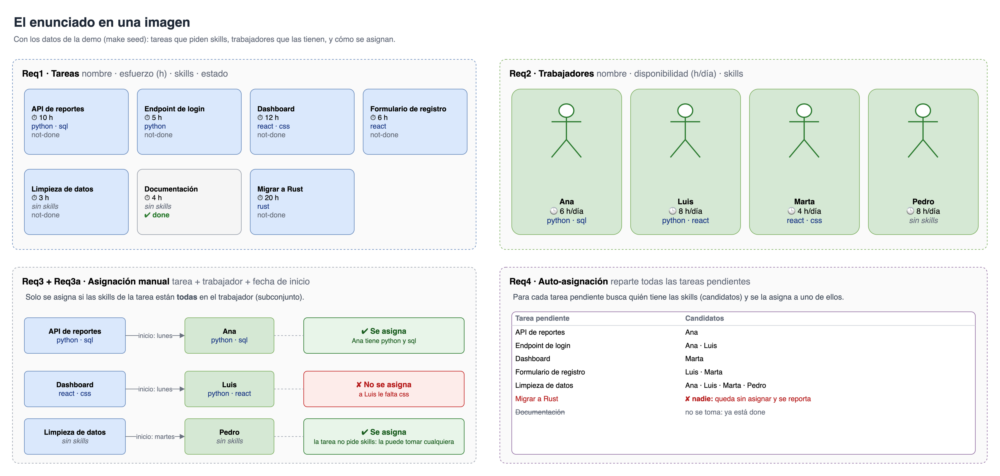

---

### 1.2. Comandos

**Requisitos:** [Docker](https://www.docker.com/), [uv](https://docs.astral.sh/uv/) (Python ≥ 3.13), [Node.js](https://nodejs.org/) ≥ 22.22 + [pnpm](https://pnpm.io/), `make`.

```bash
# Construir
make build      # instala dependencias, sincroniza los tipos de la API y construye el frontend

# Correr
make db         # Postgres en Docker
make seed       # aplica las migraciones (Alembic) y carga datos de demo (dummy)
                # en la app, los botones Reset (borra todo) y Populate (borra y recarga la demo)
                # usan POST /api/v1/dev/reset y /api/v1/dev/populate: solo para probar
make backend    # API → http://localhost:8000/docs
make frontend   # Web → http://localhost:4321 (en otra terminal)

# Probar
make test               # unit + application + integration
make test-e2e           # E2E (requiere la app corriendo)

# Otros
make api-client         # regenera los tipos TS del frontend desde el OpenAPI
make diagramas          # exporta images/diagramas/*.drawio a PNG (requiere draw.io desktop)
```

---

### 1.3. Archivos core

El núcleo de la solución son dos carpetas del backend: la **capa de dominio**, que decide, y la **capa de aplicación**, que orquesta los casos de uso. Alrededor están los adaptadores; aquí se incluye el de los repositorios, que guarda los datos (ver [Arquitectura hexagonal](#221-arquitectura-hexagonal-puertos-y-adaptadores)).

#### 1.3.1. Capa de dominio — [`backend/app/domain/`](backend/app/domain/)

<details>
<summary>Ver diagrama de la capa de dominio</summary>


</details>

| Archivo | Qué hace |
|---------|----------|
| [`models.py`](backend/app/domain/models.py) | Entidades: tarea, trabajador y asignación. |
| [`rules.py`](backend/app/domain/rules.py) | Reglas de negocio: skills, fechas, agenda y auto-asignación. |
| [`errors.py`](backend/app/domain/errors.py) | Errores de negocio. |

#### 1.3.2. Capa de aplicación — [`backend/app/application/`](backend/app/application/)

<details>
<summary>Ver diagrama de la capa de aplicación</summary>


</details>

| Archivo | Qué hace |
|---------|----------|
| [`ports.py`](backend/app/application/ports.py) | Interfaces de los repositorios y del reloj. |
| [`tasks.py`](backend/app/application/tasks.py) | CRUD de tareas. |
| [`workers.py`](backend/app/application/workers.py) | CRUD de trabajadores. |
| [`assignments.py`](backend/app/application/assignments.py) | Asignación manual, mover, eliminar y auto-asignación. |

#### 1.3.3. Capa de adaptadores (repositorios) — [`backend/app/adapters/sql/`](backend/app/adapters/sql/)

Los datos se guardan en una **base de datos relacional (PostgreSQL)**. Los repositorios implementan los puertos de la capa de aplicación: leen y guardan las entidades del dominio sobre estas tablas.

<details>
<summary>Ver adaptador SQL y modelo de datos</summary>

Así convierte cada repositorio la entidad del dominio en una fila de la base, con una transacción por request:

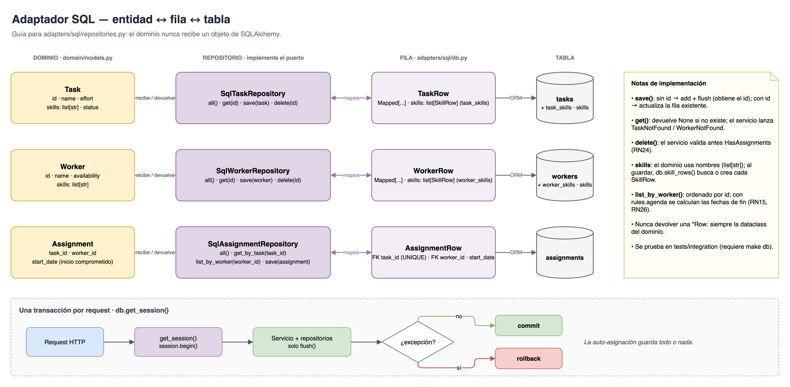

Y así está modelada la base de datos:


</details>

| Archivo | Qué hace |
|---------|----------|
| [`db.py`](backend/app/adapters/sql/db.py) | Conexión, sesión por request y tablas (SQLAlchemy). |
| [`repositories.py`](backend/app/adapters/sql/repositories.py) | Repositorios: implementan los puertos sobre Postgres. |
| [`migrations/versions/`](backend/migrations/versions/) | Esquema de la base (Alembic). |

---

## 2. Desarrollo

### 2.1. Definición de Alcance (Requerimientos)

**Objetivo:** me enfoqué en entender el problema y en eliminar ambigüedades sobre lo que se espera de la solución, partiendo de los requerimientos dados.

#### 2.1.1. Enfoque de la prueba técnica

El enfoque fue construir una **prueba de concepto (PoC)** que pueda exponer a profundidad en poco tiempo. Me tomé esta libertad porque el enunciado no especifica el nivel de profundidad al que debe llegar la solución aparte de los requerimientos base y lo deja abierto, y me siento más seguro exponiendo pocas cosas que entienda bien que una solución robusta desarrollada en poco tiempo. Por eso el enfoque **no** fue construir una aplicación robusta con trazabilidad, login, CI/CD, manuales de apoyo exhaustivos, etc...

#### 2.1.2. Reglas de negocio

Para eliminar ambigüedades de la implementación se definieron las [Reglas de Negocio](README_NEGOCIO.md) (RN1 a RN31), cada una marcada según venga del enunciado o sea una decisión propia:

| Grupo | Reglas |
|-------|--------|
| [Tareas (Req1)](README_NEGOCIO.md#1-tareas-req1) | RN1 a RN3 |
| [Trabajadores (Req2)](README_NEGOCIO.md#2-trabajadores-req2) | RN4, RN5 |
| [Asignación manual (Req3, Req3a)](README_NEGOCIO.md#3-asignación-manual-req3-req3a) | RN6 a RN11 |
| [Cálculo de fechas](README_NEGOCIO.md#4-cálculo-de-fechas) | RN12 a RN16, RN25, RN26 |
| [Auto-asignación (Req4)](README_NEGOCIO.md#5-auto-asignación-req4) | RN17 a RN21, RN27 a RN29 |
| [Edición y borrado](README_NEGOCIO.md#6-edición-y-borrado) | RN22 a RN24, RN30, RN31 |

#### 2.1.3. Supuestos principales

Antes de implementar, dejé explícitos estos supuestos para partir de una definición clara del negocio, eliminar ambigüedades y detectar lo antes posible los puntos de fricción con sus necesidades. Los casos borde no se incluyen aquí: se desarrollan en la parte de testing.

- No hay autenticación ni roles: un solo usuario administra todo.
- La disponibilidad del trabajador es la misma todos los días hábiles. Esto implica que no habrá distinción de que horas en específico dentro del día habil tiene disponible un trabajador.
- No hay festivos ni vacaciones; solo se trabaja de lunes a viernes.
- Una tarea se asigna a un solo trabajador, es decir no puede comenzar un trabajador la tarea dejarla a la mitad y continuar otro.
- Si una tarea dura más de el tiempo disponible de un trabajador en el día puede continuarla al inicio de las horas disponibles en el siguiente día. Sin embargo las tareas deben realizarse de corrido (No trabajar en parte de la tarea A el siguiente día cambiar a la tarea B y  el siguiente volver a lo que faltó de la A).
- Las tareas de un trabajador se ejecutan una tras otra, sin solaparse.
- La auto-asignación solo toma tareas sin asignar.
- Una skill se tiene o no se tiene (sin niveles).
- El esfuerzo de una tarea está definido en horas enteras.

#### 2.1.4. Exposición

Para demostrar un perfil más integral en la prueba técnica y facilitar la demo, se definió construir una interfaz web que se comunique con la aplicación mediante una API REST, la cual expone las operaciones disponibles (incluyendo los CRUD).

---

### 2.2. Arquitectura y Stack Elegidos

Se definió **Python** para la lógica core de la aplicación: las reglas de negocio y los casos de uso. Todo lo demás (la API con FastAPI, la base de datos y el frontend) son implementaciones alrededor de ese núcleo: se pueden cambiar sin tocar la lógica de negocio. Para lograrlo se definió usar **arquitectura hexagonal**, siguiendo buenas prácticas de desarrollo y haciendo flexible la implementación: el mismo núcleo puede exponerse o persistirse de varias maneras (otra API, otra base de datos, otra interfaz) sin cambiar su lógica.

#### 2.2.1. Arquitectura hexagonal (puertos y adaptadores)

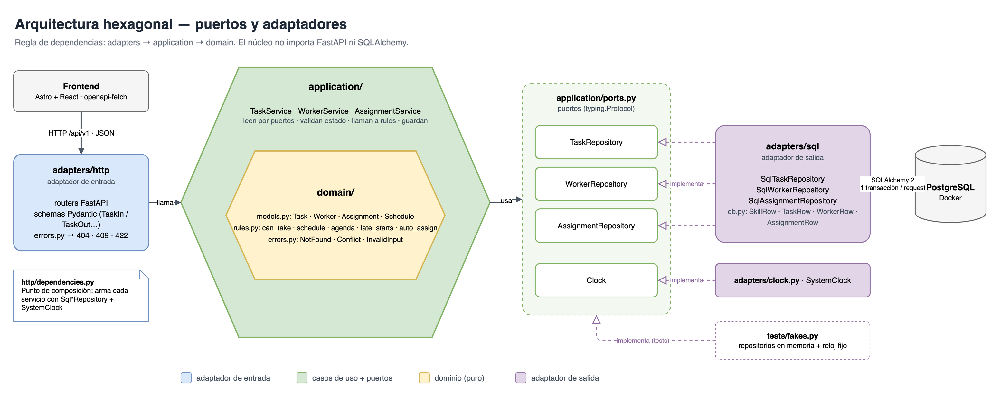

**Regla de dependencias:** `adapters → application → domain`. El dominio no importa nada de FastAPI ni de SQLAlchemy, y la aplicación solo conoce los puertos, no sus implementaciones.

#### 2.2.2. Stack

| Capa | Herramienta | Uso |
|------|-------------|---------|
| Backend | **FastAPI** (Python 3.13) | API tipada con Pydantic; genera OpenAPI y Swagger sin trabajo extra (util para testear CRUD). |
| Persistencia | **PostgreSQL** + **SQLAlchemy 2** + **Alembic** | El dominio es relacional (tareas ↔ trabajadores ↔ skills ↔ asignaciones); Alembic versiona los cambios del esquema. |
| Frontend | **Astro** + **React** | Páginas ligeras; React solo donde hay interacción (islands). |
| Contrato API | **`openapi-typescript`** + **`openapi-fetch`** + **TanStack Query** | El front usa tipos generados del OpenAPI del back: si la API cambia, el front no compila. |
| Testing | **pytest** + **Playwright** | Unit/integración en el back y E2E en el navegador. |
| Entorno | **uv**, **pnpm**, **Docker Compose** | Dependencias reproducibles y Postgres con un solo comando. |
| Comandos | **Make** | Un solo punto de entrada para construir, correr y probar. |

> **Nota:** el frontend no es el enfoque de esta prueba, por lo que su implementación se deja a Claude Code.

#### 2.2.3. Estructura

```
.
├── backend/                     # API FastAPI
│   ├── app/
│   │   ├── main.py              # app + routers bajo /api/v1 + manejo de errores de dominio
│   │   ├── domain/              # núcleo: sin FastAPI ni SQLAlchemy
│   │   │   ├── models.py            # entidades: Task, Worker, Assignment
│   │   │   ├── rules.py             # reglas puras: skills, fechas, agenda, auto-asignación
│   │   │   └── errors.py            # errores de negocio (MissingSkills, TaskDone, ...)
│   │   ├── application/         # casos de uso
│   │   │   ├── ports.py             # puertos: TaskRepository, WorkerRepository, AssignmentRepository, Clock
│   │   │   ├── tasks.py             # Req1
│   │   │   ├── workers.py           # Req2
│   │   │   └── assignments.py       # Req3, Req3a, Req4
│   │   ├── adapters/
│   │   │   ├── http/                # entrada: un archivo por recurso (schemas Pydantic + routers)
│   │   │   │   ├── tasks.py, workers.py, assignments.py
│   │   │   │   ├── dependencies.py      # composición: arma cada caso de uso con sus adaptadores
│   │   │   │   └── errors.py            # error de dominio -> 404 / 409 / 422
│   │   │   ├── sql/                 # salida: Postgres
│   │   │   │   ├── db.py                # conexión, sesión por request y filas (SkillRow, TaskRow, WorkerRow, AssignmentRow)
│   │   │   │   └── repositories.py      # implementan los puertos y mapean fila <-> entidad
│   │   │   └── clock.py             # salida: implementa Clock con la fecha del sistema
│   │   └── seed.py              # datos de demo
│   ├── migrations/              # migraciones Alembic
│   └── tests/
├── frontend/            # Astro + React
│   └── src/
│       ├── api/         # api.generated.ts (generado) + client.ts
│       └── ...
├── images/              # diagramas (.drawio + PNG) y capturas de la demo
├── docker-compose.yml   # Postgres
└── Makefile
```

---

### 2.3. Enfoque en Testing

#### 2.3.1. Qué se prueba en cada capa

Las capas siguen la [arquitectura hexagonal](#221-arquitectura-hexagonal-puertos-y-adaptadores): cada una prueba un anillo del hexágono.


#### 2.3.2. Escenarios (BDD)

Los escenarios a probar están definidos en [Escenarios de prueba (BDD)](README_BDD.md), con la sintaxis de **Gherkin** (Dado / Cuando / Entonces) y agrupados igual que las [Reglas de Negocio](README_NEGOCIO.md).


#### 2.3.3. Ejemplo: casos borde de la agenda del trabajador

<details>
<summary>Ver diagrama de inserción en la agenda</summary>

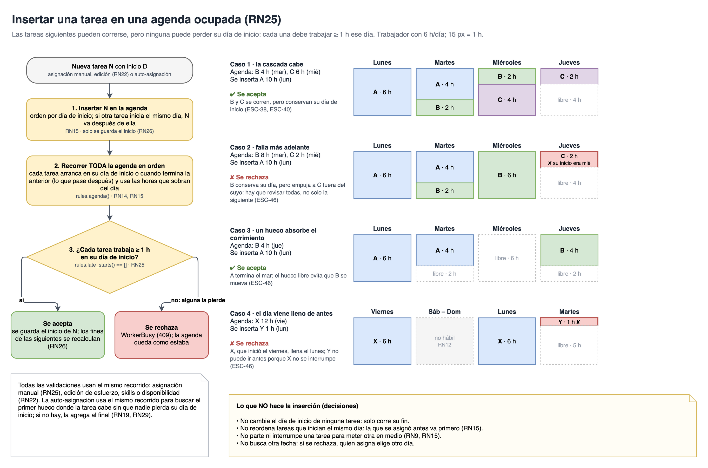

</details>

#### 2.3.4. Dónde vive cada test

Los tests se organizan **por capa y luego por funcionalidad**, no replicando las carpetas de `app/`.

```
backend/tests/
├── dates.py                        # calendario de referencia (FRI_16, MON_19, ...)
├── fakes.py                        # dobles de los puertos: repositorios en memoria y FixedClock
├── unit/                           # reglas puras (prueban app/domain/rules.py)
│   ├── test_skills.py              # ESC-08
│   ├── test_schedule.py            # ESC-09 a ESC-15, ESC-48
│   ├── test_agenda.py              # ESC-38, ESC-39, ESC-46
│   └── test_auto_assign.py         # ESC-23 a ESC-26, ESC-43 a ESC-45, ESC-50
├── application/                    # casos de uso con dobles: sin DB ni HTTP (prueban app/application/)
│   ├── conftest.py                 # repositorios en memoria, reloj fijo, servicios y fábricas
│   ├── test_assign_manually.py     # ESC-17 a ESC-22, ESC-40, ESC-41
│   ├── test_auto_assign_pending.py # ESC-27, ESC-28, ESC-47
│   └── test_edit_delete.py         # ESC-30 a ESC-32, ESC-42
└── integration/                    # adaptadores reales: API + Postgres (taskworkers_test)
    ├── conftest.py                 # client, session con rollback, "hoy" fijo y fábricas
    ├── test_tasks_api.py           # ESC-01 a ESC-04
    ├── test_workers_api.py         # ESC-05 a ESC-07
    ├── test_assignments_api.py     # ESC-16
    ├── test_auto_assign_api.py     # ESC-29
    ├── test_errors_api.py          # ESC-37
    └── test_dev_api.py             # Reset y Populate de la demo
e2e/tests/
├── smoke.spec.ts                # ESC-33
└── demo.spec.ts                 # ESC-34 a ESC-36
```

---

## 3. Demo

Con la app corriendo (ver [Comandos](#12-comandos)):

- **Frontend:** [http://localhost:4321](http://localhost:4321)
- **API (Swagger):** [http://localhost:8000/docs](http://localhost:8000/docs)

<details>
<summary>Ver capturas de la demo</summary>

Las capturas usan los datos de demo (`make seed` o el botón **Populate**).

#### Frontend

**Planificador.** Tareas por asignar a la izquierda y la agenda de cada trabajador a la derecha.

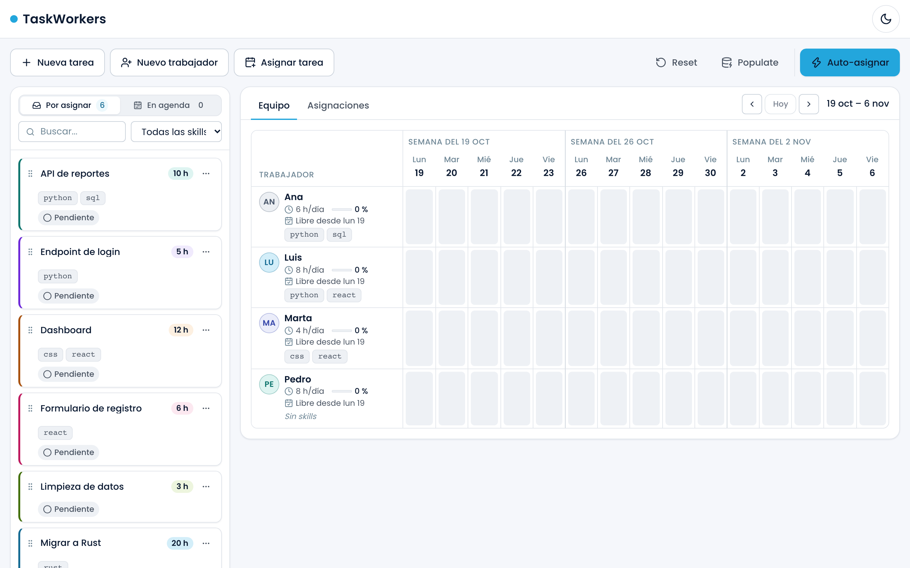

**Asignación manual.** "API de reportes" (10 h) asignada a Ana (6 h/día) desde el lunes: trabaja 6 h el lunes y 4 h el martes.

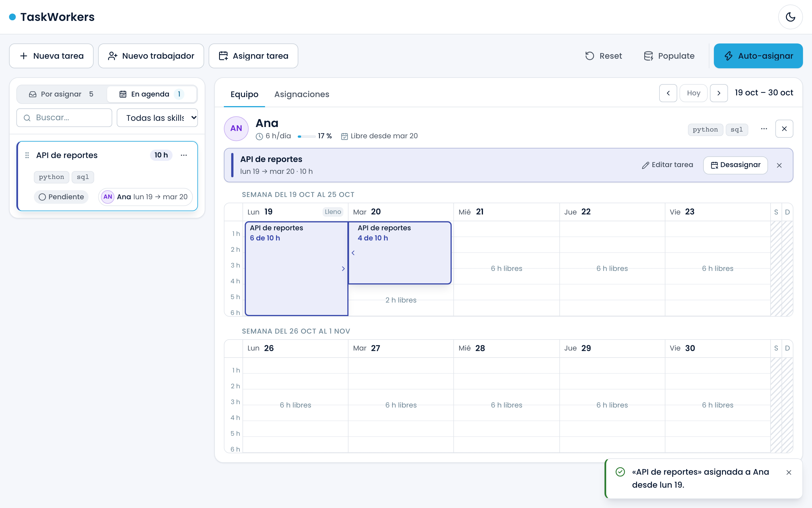

**Error: faltan skills.** Antes de enviar, la interfaz avisa que a Luis le falta `css`, y la API rechaza la asignación con el motivo.

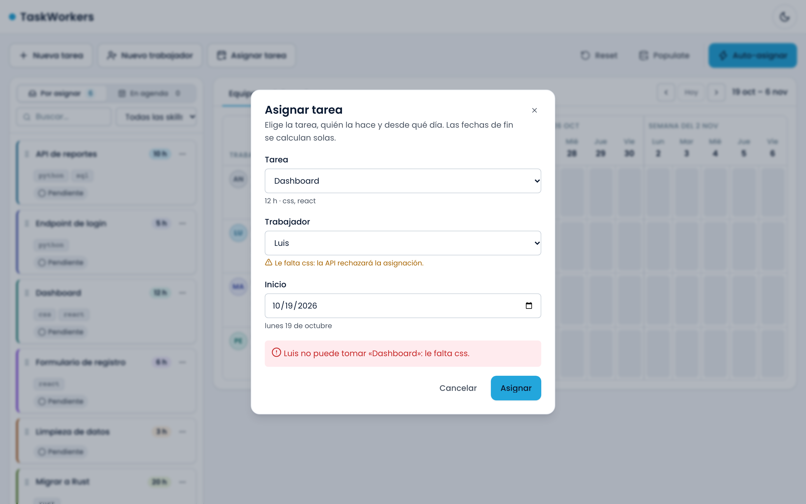

**Error: fin de semana.** Una asignación no puede empezar en sábado ni en domingo.

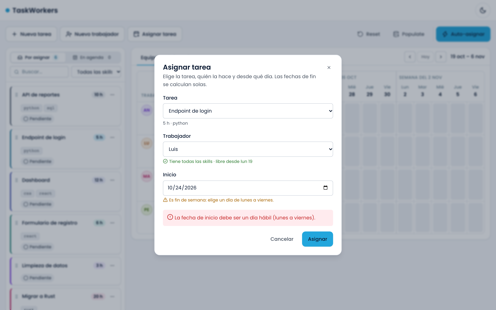

**Auto-asignación.** Reparte las tareas pendientes y reporta las que nadie puede tomar ("Migrar a Rust": nadie tiene `rust`).

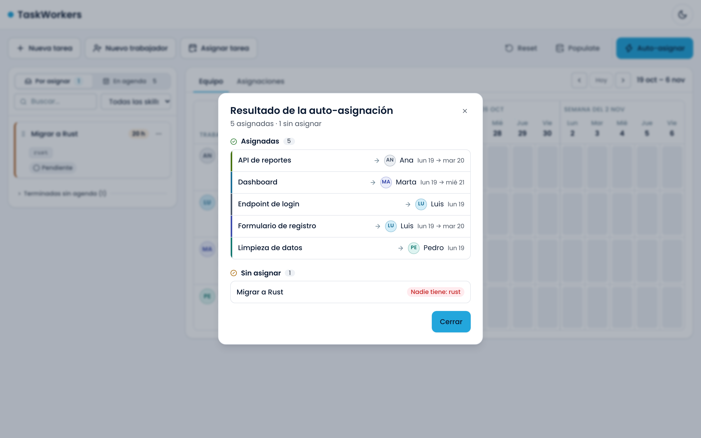

**Agenda después de auto-asignar.**

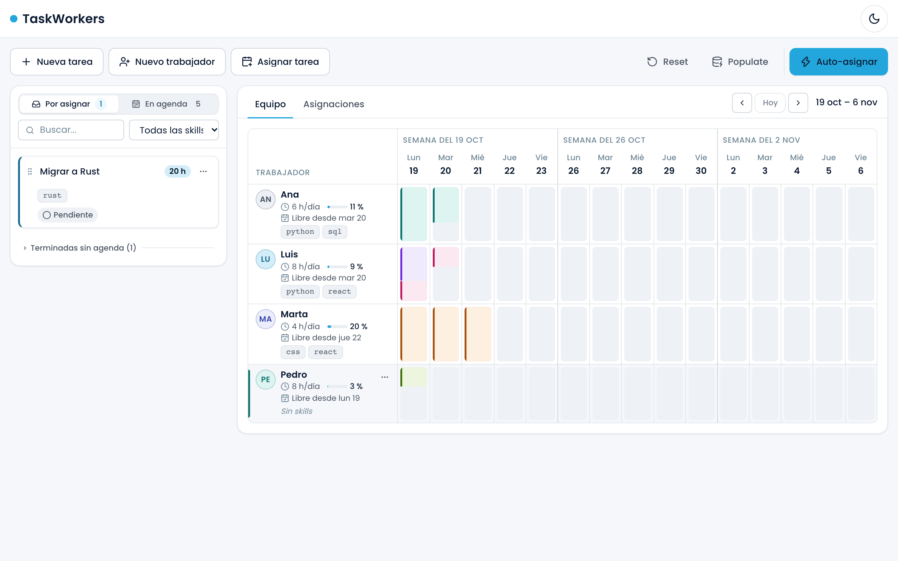

**Asignaciones.** Cada asignación con su inicio y su fin calculado.

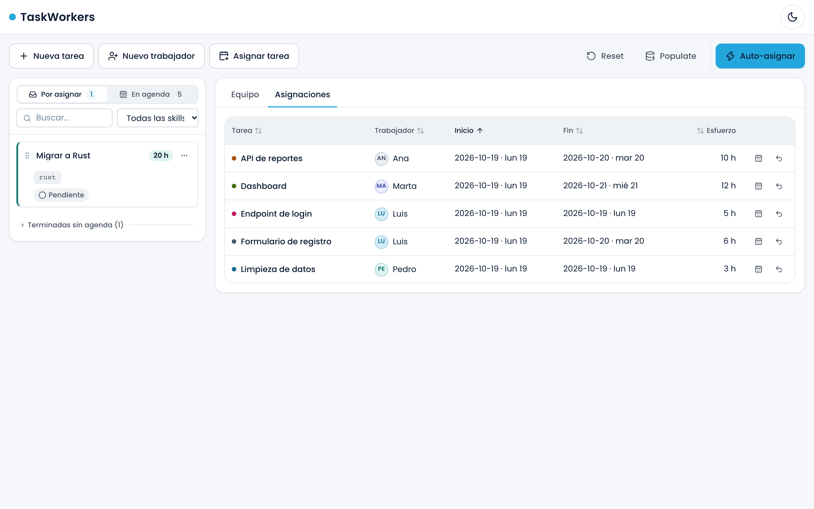

#### API (Swagger)

Todos los endpoints documentados, que se pueden probar desde el navegador: tareas, trabajadores, asignaciones (incluida la auto-asignación) y los de desarrollo (`reset` y `populate`).

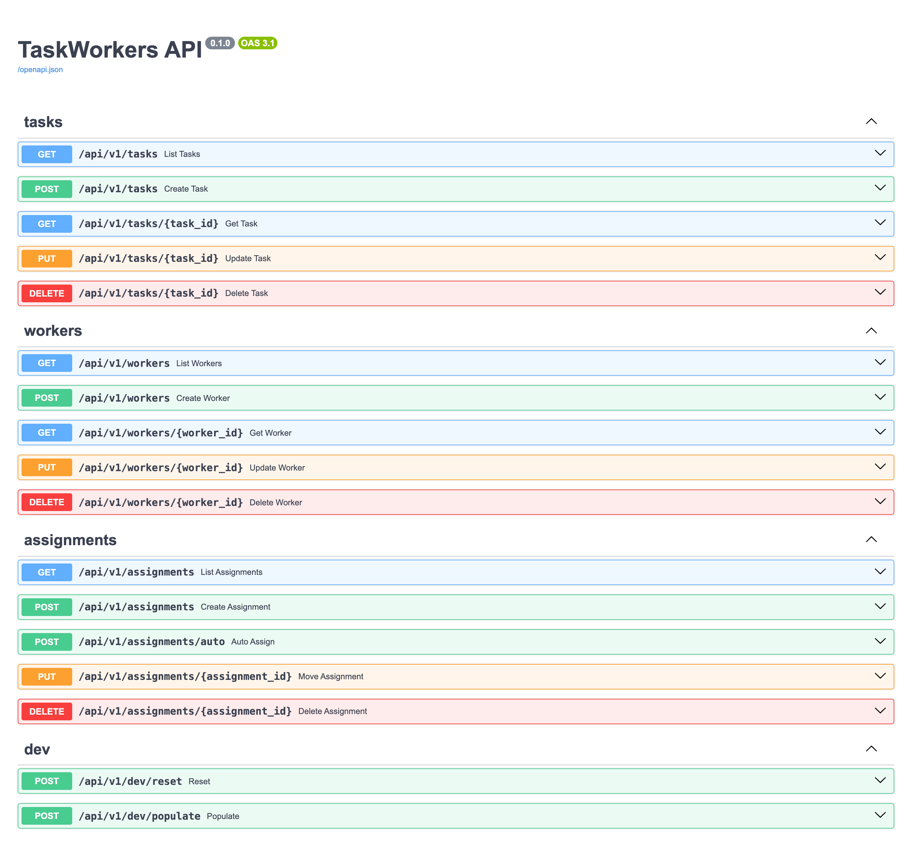

</details>
