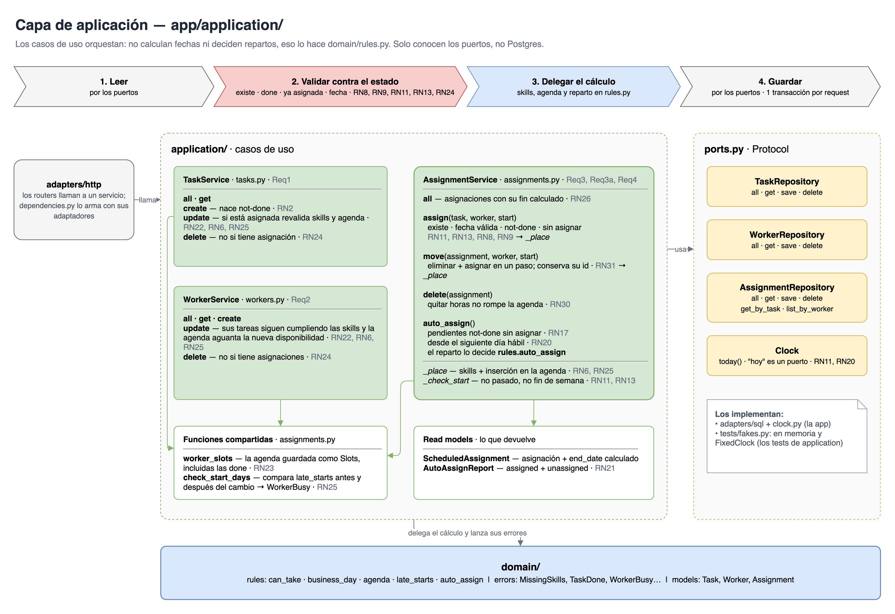
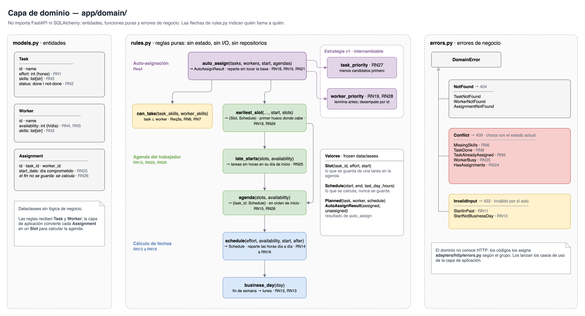
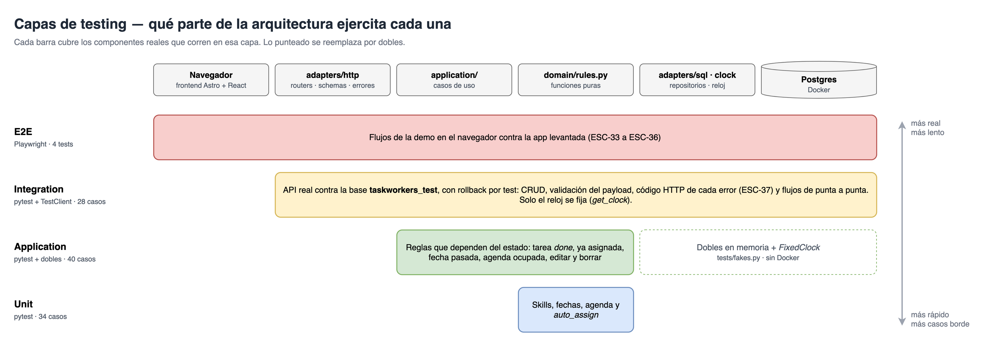
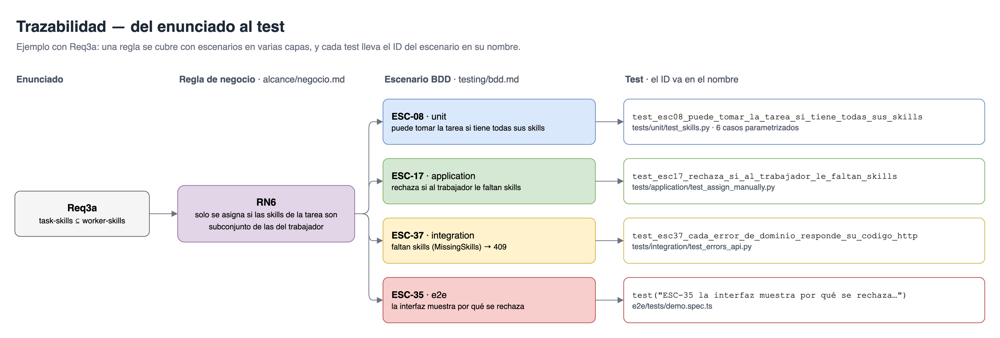
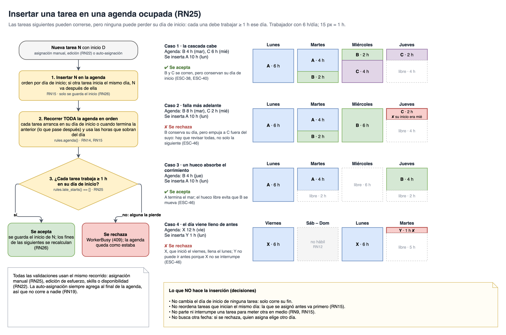

# TaskWorkers

## Índice

1. [Inicio rápido](#1-inicio-rápido)
   1. [Enunciado](#11-enunciado)
   1. [Comandos](#12-comandos)
   1. [Archivos core](#13-archivos-core)
      1. [Capa de aplicación](#131-capa-de-aplicación--backendappapplication)
      1. [Capa de dominio](#132-capa-de-dominio--backendappdomain)
1. [Desarrollo](#2-desarrollo)
   1. [Definición de Alcance (Requerimientos)](#21-definición-de-alcance-requerimientos)
      1. [Enfoque de la prueba técnica](#211-enfoque-de-la-prueba-técnica)
      1. [Reglas de negocio](#212-reglas-de-negocio)
      1. [Supuestos principales](#213-supuestos-principales)
      1. [Exposición](#214-exposición)
   1. [Arquitectura y Stack Elegidos](#22-arquitectura-y-stack-elegidos)
      1. [Stack](#221-stack)
      1. [Arquitectura hexagonal (puertos y adaptadores)](#222-arquitectura-hexagonal-puertos-y-adaptadores)
      1. [Estructura](#223-estructura)
   1. [Enfoque en Testing](#23-enfoque-en-testing)
      1. [Qué se prueba en cada capa](#231-qué-se-prueba-en-cada-capa)
      1. [Escenarios (BDD)](#232-escenarios-bdd)
      1. [Dónde vive cada test](#233-dónde-vive-cada-test)
      1. [Cómo correrlos](#234-cómo-correrlos)

---

## 1. Inicio rápido

### 1.1. Enunciado

Implement an application that covers the following requirements

- **Req1:** Application should CRUD tasks : Task-name, effort (hours), skills, status (done, not-done)
- **Req2:** Application should CRUD workers : worker-name, Availability(hours/day), skills
- **Req3:** Application should allow manual assignment of tasks to workers ( worker, tasks, datestart)
- **Req3a:** Assignment is only allowed if task-skills are a subset of worker-skills.
- **Req4:** Auto-Assignment, implement an auto-assignment feature.

Upload the code to a git repo of your choice and share the link.

it should contain script that

- build / run / test the application.
- Populate the app with data show test/present the app

**Considerations**

hours can be just integers. Working days are mon-fri.

---

### 1.2. Comandos

**Requisitos:** [Docker](https://www.docker.com/), [uv](https://docs.astral.sh/uv/) (Python ≥ 3.13), [Node.js](https://nodejs.org/) ≥ 22.22 + [pnpm](https://pnpm.io/), `make`.

```bash
# Construir
make build      # instala dependencias, sincroniza los tipos de la API y construye el frontend

# Correr
make db         # Postgres en Docker
make seed       # aplica las migraciones (Alembic) y carga datos de demo (dummy)
                # en la app, los botones Reset (borra todo) y Populate (borra y recarga la demo)
                # usan POST /api/v1/dev/reset y /api/v1/dev/populate: solo para probar
make backend    # API → http://localhost:8000/docs
make frontend   # Web → http://localhost:4321 (en otra terminal)

# Probar
make test               # unit + application + integration
make test-e2e           # E2E (requiere la app corriendo)

# Otros
make api-client         # regenera los tipos TS del frontend desde el OpenAPI
make diagramas          # exporta docs/diagramas/*.drawio a PNG (requiere draw.io desktop)
```

---

### 1.3. Archivos core

El núcleo de la solución son dos carpetas del backend: la **capa de aplicación**, que orquesta los casos de uso, y la **capa de dominio**, que decide. El resto (HTTP, SQL, frontend) son adaptadores alrededor de ellas (ver [Arquitectura hexagonal](#222-arquitectura-hexagonal-puertos-y-adaptadores)).

#### 1.3.1. Capa de aplicación — [`backend/app/application/`](backend/app/application/)

Los casos de uso leen por los puertos, validan contra el estado actual, delegan el cálculo a `domain/rules.py` y guardan. No conocen Postgres ni FastAPI.



| Archivo | Qué hace |
|---------|----------|
| [`ports.py`](backend/app/application/ports.py) | Interfaces de los repositorios y del reloj. |
| [`tasks.py`](backend/app/application/tasks.py) | CRUD de tareas. |
| [`workers.py`](backend/app/application/workers.py) | CRUD de trabajadores. |
| [`assignments.py`](backend/app/application/assignments.py) | Asignación manual, mover, eliminar y auto-asignación. |

#### 1.3.2. Capa de dominio — [`backend/app/domain/`](backend/app/domain/)

Entidades, reglas puras y errores de negocio. No importa nada de FastAPI ni de SQLAlchemy, y todo se prueba con tests unitarios.



| Archivo | Qué hace |
|---------|----------|
| [`models.py`](backend/app/domain/models.py) | Entidades: tarea, trabajador y asignación. |
| [`rules.py`](backend/app/domain/rules.py) | Reglas de negocio: skills, fechas, agenda y auto-asignación. |
| [`errors.py`](backend/app/domain/errors.py) | Errores de negocio. |

---

## 2. Desarrollo

### 2.1. Definición de Alcance (Requerimientos)

**Objetivo:** me enfoqué en entender el problema y en eliminar ambigüedades sobre lo que se espera de la solución, partiendo de los requerimientos dados.

#### 2.1.1. Enfoque de la prueba técnica

El enfoque fue construir una **prueba de concepto (PoC)** que pueda exponer a profundidad en poco tiempo. Me tomé esta libertad porque el enunciado no especifica el nivel de profundidad al que debe llegar la solución aparte de los requerimientos base y lo deja abierto, y me siento más seguro exponiendo pocas cosas que entienda bien que una solución robusta desarrollada en poco tiempo. Por eso el enfoque **no** fue construir una aplicación robusta con trazabilidad, login, CI/CD, manuales de apoyo exhaustivos, etc...

#### 2.1.2. Reglas de negocio

Para eliminar ambigüedades de la implementación se definieron las [Reglas de Negocio](docs/alcance/negocio.md) (RN1 a RN31), cada una marcada según venga del enunciado o sea una decisión propia:

| Grupo | Reglas |
|-------|--------|
| [Tareas (Req1)](docs/alcance/negocio.md#1-tareas-req1) | RN1 a RN3 |
| [Trabajadores (Req2)](docs/alcance/negocio.md#2-trabajadores-req2) | RN4, RN5 |
| [Asignación manual (Req3, Req3a)](docs/alcance/negocio.md#3-asignación-manual-req3-req3a) | RN6 a RN11 |
| [Cálculo de fechas](docs/alcance/negocio.md#4-cálculo-de-fechas) | RN12 a RN16, RN25, RN26 |
| [Auto-asignación (Req4)](docs/alcance/negocio.md#5-auto-asignación-req4) | RN17 a RN21, RN27 a RN29 |
| [Edición y borrado](docs/alcance/negocio.md#6-edición-y-borrado) | RN22 a RN24, RN30, RN31 |

#### 2.1.3. Supuestos principales

Me parece relevante aclarar para partir de una definición del negocio más clara y eliminar ambiguedades con el fin de identificar posibles puntos de fricción con las necesidades del negocio lo más antes posible. (esto no incluye los casos edge que serán desarrollados en la parte de testing).

- No hay autenticación ni roles: un solo usuario administra todo.
- La disponibilidad del trabajador es la misma todos los días hábiles. Esto implica que no habrá distinción de que horas en específico dentro del día habil tiene disponible un trabajador.
- No hay festivos ni vacaciones; solo se trabaja de lunes a viernes.
- Una tarea se asigna a un solo trabajador, es decir no puede comenzar un trabajador la tarea dejarla a la mitad y continuar otro.
- Si una tarea dura más de el tiempo disponible de un trabajador en el día puede continuarla al inicio de las horas disponibles en el siguiente día. Sin embargo las tareas deben realizarse de corrido (No trabajar en parte de la tarea A el siguiente día cambiar a la tarea B y  el siguiente volver a lo que faltó de la A).
- Las tareas de un trabajador se ejecutan una tras otra, sin solaparse.
- La auto-asignación solo toma tareas sin asignar.
- Una skill se tiene o no se tiene (sin niveles).
- El esfuerzo de una tarea está definido en horas enteras.

#### 2.1.4. Exposición

Para demostrar un perfil más integral en la prueba técnica y facilitar la demo, se definió construir una interfaz web que se comunique con la aplicación mediante una API REST, la cual expone las operaciones disponibles (incluyendo los CRUD).

---

### 2.2. Arquitectura y Stack Elegidos

#### 2.2.1. Stack

| Capa | Herramienta | Uso |
|------|-------------|---------|
| Backend | **FastAPI** (Python 3.13) | API tipada con Pydantic; genera OpenAPI y Swagger sin trabajo extra (util para testear CRUD). |
| Persistencia | **PostgreSQL** + **SQLAlchemy 2** + **Alembic** | El dominio es relacional (tareas ↔ trabajadores ↔ skills ↔ asignaciones); Alembic versiona los cambios del esquema. |
| Frontend | **Astro** + **React** | Páginas ligeras; React solo donde hay interacción (islands). |
| Contrato API | **`openapi-typescript`** + **`openapi-fetch`** + **TanStack Query** | El front usa tipos generados del OpenAPI del back: si la API cambia, el front no compila. |
| Testing | **pytest** + **Playwright** | Unit/integración en el back y E2E en el navegador. |
| Entorno | **uv**, **pnpm**, **Docker Compose** | Dependencias reproducibles y Postgres con un solo comando. |
| Comandos | **Make** | Un solo punto de entrada para construir, correr y probar. |

> **Nota:** el frontend no es el enfoque de esta prueba, por lo que su implementación se deja a Claude Code.

#### 2.2.2. Arquitectura hexagonal (puertos y adaptadores)


**Regla de dependencias:** `adapters → application → domain`. El dominio no importa nada de FastAPI ni de SQLAlchemy, y la aplicación solo conoce los puertos, no sus implementaciones.

**Decisiones de diseño:**

- **El dominio no depende de nada.** `domain/` son dataclasses (`Task`, `Worker`, `Assignment`, y los valores `Slot` y `Schedule` en `rules.py`) y funciones puras. El núcleo del problema (skills, fechas y auto-asignación) se lee en un solo archivo, `domain/rules.py`, y se prueba con tests unitarios.
- **Los casos de uso orquestan.** `application/` lee por los puertos, valida contra el estado actual (tarea `done`, ya asignada, fecha pasada), llama a `rules.py` y guarda. Los puertos (`ports.py`) son `Protocol`: los repositorios y el `Clock`.
- **Adaptadores en `adapters/`.**
  - De entrada: `http/`, con un archivo por recurso que junta schemas Pydantic y routers sin lógica.
  - De salida: `sql/` (SQLAlchemy) y `clock.py`.
  - `http/dependencies.py` es el punto de composición: arma cada caso de uso con sus adaptadores.
- **Errores de dominio, no HTTP.** Los casos de uso lanzan `MissingSkills`, `TaskDone`, `StartInPast`, etc., agrupados en `NotFound`, `Conflict` e `InvalidInput`. `http/errors.py` traduce cada grupo a `404`, `409` y `422`.
- **Dos representaciones de cada entidad**: `Task` (dominio) y `TaskRow` (SQLAlchemy), mapeadas por los repositorios. Es el costo principal de la arquitectura. A cambio, los casos de uso se prueban con repositorios en memoria, sin Postgres.
- **Una transacción por request.** `get_session` hace commit al terminar o rollback si hubo error, y los repositorios solo hacen `flush`. Así la auto-asignación guarda todo o nada.
- **"Hoy" es un puerto (`Clock`)**, para que los tests fijen la fecha (RN11, RN20).
- **Skills en una tabla propia** (`skills`, con `task_skills` y `worker_skills`), para cruzar tareas y trabajadores por skill. En el dominio siguen siendo una lista de nombres (RN3); los repositorios hacen la traducción.
- **De una asignación solo se guarda la fecha de inicio** (RN26). Las fechas de fin se calculan con `rules.agenda`, recorriendo la agenda del trabajador, y la API las expone en un read model (`ScheduledAssignment`). Así hay una sola fuente de verdad y editar una tarea o un trabajador no deja fechas desincronizadas; a cambio, esas ediciones revalidan la agenda (RN22, RN25).

#### 2.2.3. Estructura

```
.
├── backend/                     # API FastAPI
│   ├── app/
│   │   ├── main.py              # app + routers bajo /api/v1 + manejo de errores de dominio
│   │   ├── domain/              # núcleo: sin FastAPI ni SQLAlchemy
│   │   │   ├── models.py            # entidades: Task, Worker, Assignment
│   │   │   ├── rules.py             # reglas puras: skills, fechas, agenda, auto-asignación
│   │   │   └── errors.py            # errores de negocio (MissingSkills, TaskDone, ...)
│   │   ├── application/         # casos de uso
│   │   │   ├── ports.py             # puertos: TaskRepository, WorkerRepository, AssignmentRepository, Clock
│   │   │   ├── tasks.py             # Req1
│   │   │   ├── workers.py           # Req2
│   │   │   └── assignments.py       # Req3, Req3a, Req4
│   │   ├── adapters/
│   │   │   ├── http/                # entrada: un archivo por recurso (schemas Pydantic + routers)
│   │   │   │   ├── tasks.py, workers.py, assignments.py
│   │   │   │   ├── dependencies.py      # composición: arma cada caso de uso con sus adaptadores
│   │   │   │   └── errors.py            # error de dominio -> 404 / 409 / 422
│   │   │   ├── sql/                 # salida: Postgres
│   │   │   │   ├── db.py                # conexión, sesión por request y filas (SkillRow, TaskRow, WorkerRow, AssignmentRow)
│   │   │   │   └── repositories.py      # implementan los puertos y mapean fila <-> entidad
│   │   │   └── clock.py             # salida: implementa Clock con la fecha del sistema
│   │   └── seed.py              # datos de demo
│   ├── migrations/              # migraciones Alembic
│   └── tests/
├── frontend/            # Astro + React
│   └── src/
│       ├── api/         # api.generated.ts (generado) + client.ts
│       ├── features/    # una carpeta por feature (componentes React + index.ts)
│       ├── i18n/        # textos de la UI (es.ts) + t('clave')
│       ├── layouts/     # BaseLayout + header
│       ├── pages/       # páginas Astro (delgadas)
│       ├── shared/      # componentes y utilidades reutilizables
│       └── styles/      # tokens de diseño (claro/oscuro) + estilos base
│                        # ver docs/diseno-ui.md
├── docs/                # documentación
├── docker-compose.yml   # Postgres
└── Makefile
```

---

### 2.3. Enfoque en Testing

**Objetivo:** justificar qué se prueba en cada capa, dónde vive cada test y cómo correrlos.

#### 2.3.1. Qué se prueba en cada capa

Las capas siguen la [arquitectura hexagonal](#222-arquitectura-hexagonal-puertos-y-adaptadores): cada una prueba un anillo del hexágono.



| Capa | Qué prueba | Qué no prueba | Herramienta |
|------|------------|---------------|-------------|
| **Unit** | Las reglas puras de `domain/rules.py`: subconjunto de skills, cálculo de fechas, agenda del trabajador y elección de candidato en la auto-asignación. | Casos de uso, HTTP ni base de datos. | pytest |
| **Application** | Los casos de uso de `application/` contra repositorios en memoria y un reloj fijo, es decir, las reglas que dependen del estado: tarea `done`, ya asignada, fecha pasada, agenda ocupada, qué toma la auto-asignación y editar o borrar con asignaciones. | HTTP ni Postgres. | pytest + dobles (`tests/fakes.py`) |
| **Integration** | Los adaptadores contra Postgres real: CRUD y validación del payload, que cada error de dominio llegue con su código HTTP y los flujos de asignación de punta a punta. | Reglas ya cubiertas en application. | pytest + `TestClient` |
| **E2E** | Los flujos de la demo desde el navegador. | Casos borde (ya cubiertos abajo). | Playwright |

**Por qué esta división:**

- El núcleo del problema (fechas, skills, auto-asignación) son **funciones puras**: se prueban rápido y con muchos casos borde sin levantar nada.
- Las reglas que dependen del estado se prueban **contra los puertos con dobles en memoria**: tardan milisegundos y no necesitan Docker. Cada test prepara solo el estado que le importa.
- Integration queda para lo que los dobles no pueden garantizar: que los **adaptadores reales** cumplan el contrato (mapeo fila ↔ entidad, transacciones, códigos HTTP).
- Integration usa **Postgres real** (base `taskworkers_test`), no SQLite, para probar el mismo motor que la app. Cada test corre en una transacción que se revierte al final, así los tests no se contaminan entre sí.
- E2E son **pocos** y solo de los flujos que se muestran en la demo, porque son lentos y frágiles.
- E2E **no es el enfoque de esta prueba**: su implementación se deja a Claude Code a partir de los escenarios definidos en [Escenarios de prueba (BDD)](docs/testing/bdd.md).

**Decisiones para que los tests sean deterministas:**

- **"Hoy" es un puerto (`Clock`)**: la lógica no lee el reloj. En application se usa `FixedClock`, y en integration se sobreescribe `get_clock`. Así RN11 y RN20 se prueban con una fecha fija.
- **Convención de códigos de error:** los casos de uso lanzan errores de dominio y [`adapters/http/errors.py`](backend/app/adapters/http/errors.py) los traduce por grupo (ESC-37):
  - `404` (`NotFound`): la tarea, el trabajador o la asignación no existe.
  - `422` (`InvalidInput` o validación de Pydantic): el payload es inválido por sí solo (esfuerzo 0, disponibilidad 25, fecha pasada).
  - `409` (`Conflict`): la operación choca con el estado actual de los datos (skills no compatibles, tarea `done`, tarea ya asignada, una tarea pierde su día de inicio, borrar con asignaciones).

#### 2.3.2. Escenarios (BDD)

Los escenarios a probar están definidos en [Escenarios de prueba (BDD)](docs/testing/bdd.md), en formato Dado / Cuando / Entonces y agrupados igual que las [Reglas de Negocio](docs/alcance/negocio.md).

- Cada escenario tiene un ID (`ESC-17`), la regla que cubre (`RN6`) y la capa donde se prueba.
- El test lleva el ID en el nombre: `test_esc17_rechaza_si_al_trabajador_le_faltan_skills` (pytest) o `test("ESC-34 ...")` (Playwright). Así se traza **RN → escenario → test**.
- Los escenarios son especificación, no se ejecutan directamente (no se usa `pytest-bdd`): se implementan como tests normales.
- Flujo de trabajo: primero se escriben todos los tests a partir de los escenarios (en rojo) y la implementación los va pasando a verde.
- **Punto de partida (RED):** la estructura completa existe: entidades, errores y puertos; filas SQL y migración; routers, inyección de dependencias y traducción de errores a HTTP. Lo que no está implementado lanza `NotImplementedError` indicando las reglas que debe cumplir: las funciones de `domain/rules.py`, los casos de uso de `application/` y los repositorios SQL. Las validaciones de los schemas quedan como `TODO RNx`.
- El "Dado" se prepara con las fábricas `make_task`, `make_worker` y `make_assignment`, que tienen la misma firma en las dos capas. En application escriben en los repositorios en memoria y en integration directo en la base. En ningún caso pasan por el caso de uso o la API que se está probando, así cada test falla solo por lo que prueba.



Los casos borde más delicados son los de la agenda del trabajador (RN25): una tarea nueva puede correr el fin de las siguientes, pero ninguna puede perder su día de inicio. Este diagrama resume esos casos, que se prueban en ESC-46 (`unit/test_agenda.py`) y ESC-40/ESC-41 (`application/test_assign_manually.py`):



#### 2.3.3. Dónde vive cada test

Los tests se organizan **por capa y luego por funcionalidad**, no replicando las carpetas de `app/`.

```
backend/tests/
├── dates.py                        # calendario de referencia (FRI_16, MON_19, ...)
├── fakes.py                        # dobles de los puertos: repositorios en memoria y FixedClock
├── unit/                           # reglas puras (prueban app/domain/rules.py)
│   ├── test_skills.py              # ESC-08
│   ├── test_schedule.py            # ESC-09 a ESC-15, ESC-48
│   ├── test_agenda.py              # ESC-38, ESC-39, ESC-46
│   └── test_auto_assign.py         # ESC-23 a ESC-26, ESC-43 a ESC-45, ESC-50
├── application/                    # casos de uso con dobles: sin DB ni HTTP (prueban app/application/)
│   ├── conftest.py                 # repositorios en memoria, reloj fijo, servicios y fábricas
│   ├── test_assign_manually.py     # ESC-17 a ESC-22, ESC-40, ESC-41
│   ├── test_auto_assign_pending.py # ESC-27, ESC-28, ESC-47
│   └── test_edit_delete.py         # ESC-30 a ESC-32, ESC-42
└── integration/                    # adaptadores reales: API + Postgres (taskworkers_test)
    ├── conftest.py                 # client, session con rollback, "hoy" fijo y fábricas
    ├── test_tasks_api.py           # ESC-01 a ESC-04
    ├── test_workers_api.py         # ESC-05 a ESC-07
    ├── test_assignments_api.py     # ESC-16
    ├── test_auto_assign_api.py     # ESC-29
    ├── test_errors_api.py          # ESC-37
    └── test_dev_api.py             # Reset y Populate de la demo
e2e/tests/
├── smoke.spec.ts                # ESC-33
└── demo.spec.ts                 # ESC-34 a ESC-36
```

#### 2.3.4. Cómo correrlos

| Comando | Qué corre | Requisito |
|---------|-----------|-----------|
| `make test` | unit + application + integration | `make db` |
| `make test-unit` | solo unit | — |
| `make test-application` | solo application | — |
| `make test-integration` | solo integration (crea `taskworkers_test` si no existe) | `make db` |
| `make test-e2e` | E2E en navegador headless; `HEADED=1` lo abre visible | app corriendo (`db`, `seed`, `backend`, `frontend`) |

Para correr un solo escenario:

```bash
cd backend && uv run pytest -k esc17      # pytest
cd e2e && pnpm test -g "ESC-34"           # Playwright
```

---

> **Nota sobre el uso de IA:** en varias partes de la solución usé Claude Code como asistente de código. Normalmente lo combino con metodologías más robustas como [AI-DLC de AWS](https://github.com/awslabs/aidlc-workflows). Sin embargo, con ánimo de enfocarse en construir una prueba de concepto pueda exponer a profundidad en poco tiempo, definí usarlo para tareas muy específicas.
