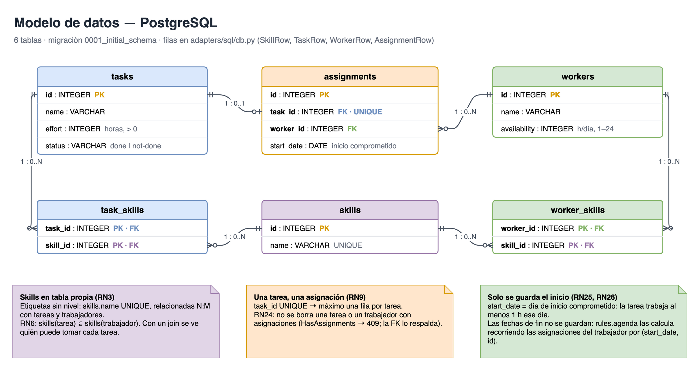
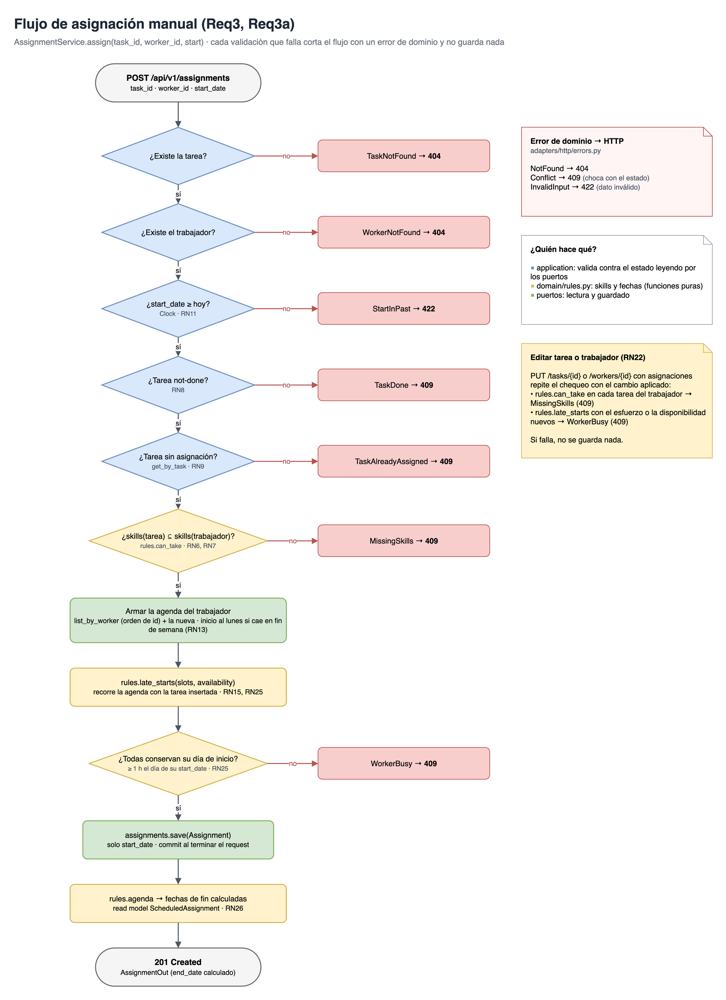
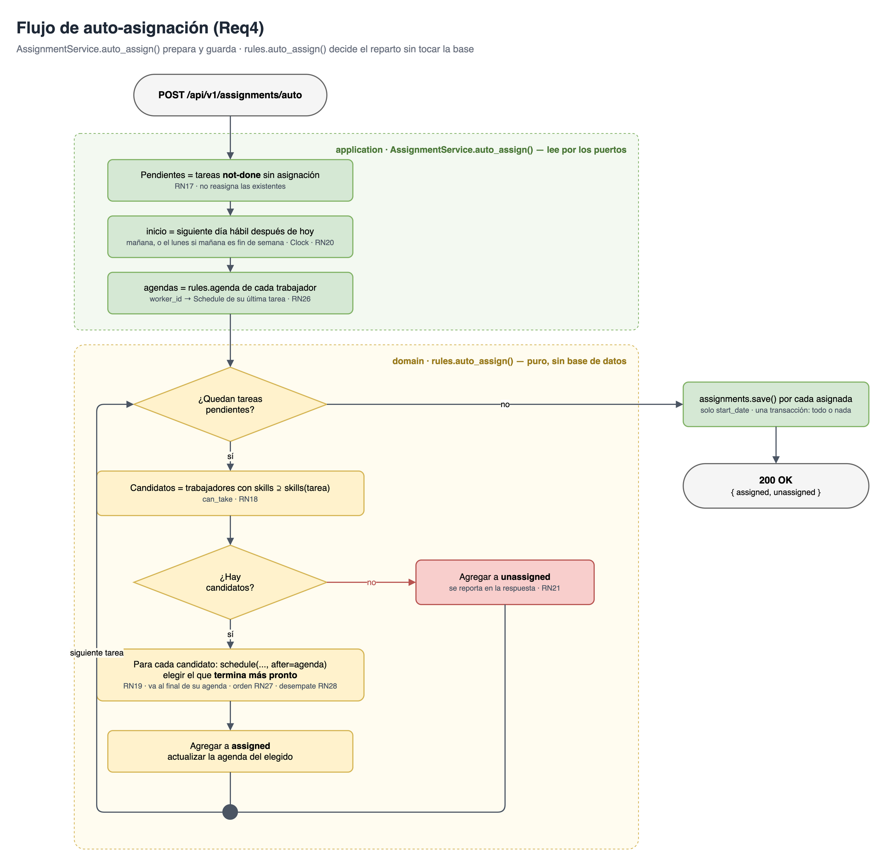
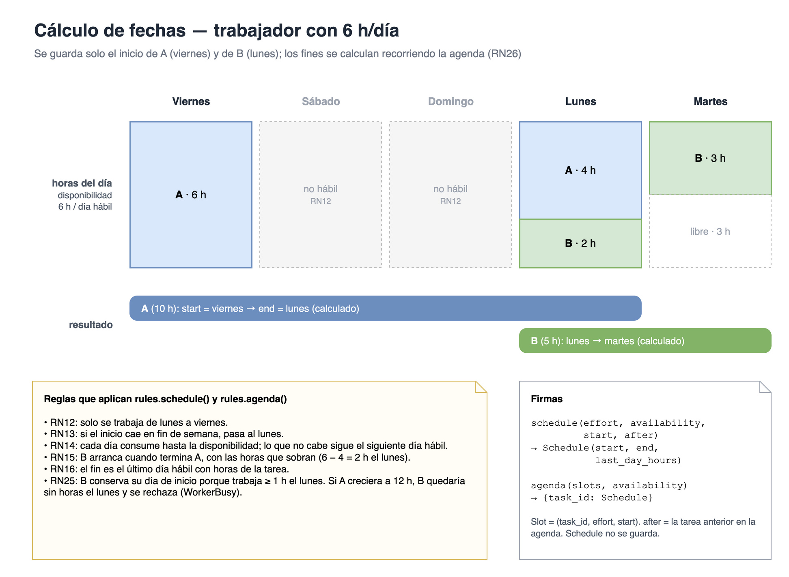

[← Volver a README](../README.md)

# Modelado de Flujos y Entidades

**Objetivo:** mostrar con diagramas las entidades, sus relaciones y los flujos principales.

> Las fuentes son los `.drawio` de [`docs/diagramas/`](diagramas/) (se editan con draw.io). `make diagramas` regenera los PNG en `docs/diagramas/img/`.

## Índice

1. [Modelo de datos](#1-modelo-de-datos)
2. [Arquitectura hexagonal](#2-arquitectura-hexagonal)
3. [Adaptador SQL](#3-adaptador-sql)
4. [Flujo de asignación manual](#4-flujo-de-asignación-manual)
5. [Flujo de auto-asignación](#5-flujo-de-auto-asignación)
6. [Cálculo de fechas](#6-cálculo-de-fechas)
7. [Inserción en la agenda](#7-inserción-en-la-agenda)

---

## 1. Modelo de datos

Seis tablas: una tarea tiene como máximo una asignación (`task_id UNIQUE`, RN9) y un trabajador puede tener muchas. Las skills viven en su propia tabla, relacionada N:M con tareas y trabajadores (RN3). De la asignación solo se guarda el día de inicio comprometido; las fechas de fin se calculan (RN25, RN26).

## 2. Arquitectura hexagonal

El núcleo (`application` + `domain`) solo conoce los puertos; Postgres, el reloj y los fakes de los tests son intercambiables.

## 3. Adaptador SQL

Cada repositorio mapea entre la dataclass del dominio y la fila de SQLAlchemy. Los repositorios solo hacen `flush`; el commit o rollback es uno por request.

## 4. Flujo de asignación manual

Validaciones de `AssignmentService.assign()` y el código HTTP de cada error de dominio. La tarea se inserta en la agenda del trabajador y se rechaza si alguna pierde su día de inicio (RN25). Editar una tarea o un trabajador repite ese chequeo (RN22). El detalle del chequeo está en [Inserción en la agenda](#7-inserción-en-la-agenda).

## 5. Flujo de auto-asignación

La aplicación prepara los datos y guarda; `rules.auto_assign()` decide el reparto sin tocar la base.

## 6. Cálculo de fechas

Ejemplo de RN12 a RN16 y RN25 con un trabajador de 6 h/día (el mismo de [Reglas de Negocio](alcance/negocio.md#4-cálculo-de-fechas)).

## 7. Inserción en la agenda

Cómo se decide si una tarea cabe en una agenda ocupada (RN25): se inserta por día de inicio, se recorre toda la agenda y se rechaza si alguna tarea queda sin horas en su día de inicio. Incluye los casos borde: una falla varias tareas más adelante, un hueco que absorbe el corrimiento y un día que ya viene lleno desde antes.

